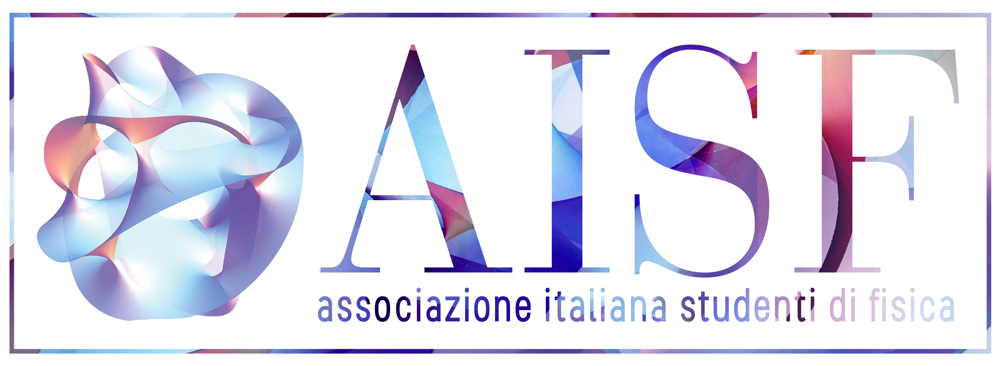

  

<h3 align="center">Associazione Italiana Studenti di Fisica</h3>

  <a href="https://ai-sf.it">Sito</a> ·
  <a href="https://www.facebook.com/aisf.fisica/">Facebook</a> ·
  <a href="https://www.instagram.com/aisf_physics/">Instagram</a> ·
  <a href="https://twitter.com/aisf_fisica">Twitter</a>

## AISF

L'Associazione Italiana Studenti di Fisica è un'associazione no-profit con finalità culturali nata nel 2014 con l'obiettivo di creare un network nazionale tra studenti di Fisica e promuovere la scienza e, in particolare, la Fisica. I suoi membri sono Comitati Locali e membri individuali, che si incontrano regolarmente in conferenze e iniziative di carattere locale, nazionale e internazionale.

## IAPS

L'International Association of Physics Students è una *umbrella organization* che dal 1987 promuove la collaborazione tra studenti e associazioni di Fisica in tutto il mondo. I suoi membri sono rappresentati da Comitati Nazionali e Locali. IAPS rappresenta oggi più di 60000 studenti, contando 26 National Committee e 21 Local Committee in più di 50 Stati. AISF è il Comitato Nazionale per l'Italia.

## Gli eventi

L'AISF organizza attività sia per studenti italiani che per quelli della più larga comunità di IAPS. Oltre ai grandi eventi nazionali e internazionali, i comitati locali organizzano frequentemente altre attività nelle università di affiliazione.

## Questa organizzazione

Qui trovi i repository dei siti web degli eventi e delle iniziative AISF (ad esempio TIQIT, Lights of Tuscany, PAPAP, Sezione Giovani, PLANCKS) e del [sito dell'associazione](https://github.com/ai-sf/ai-sf.github.io).

## Contatti

[Presidente](mailto:presidente@ai-sf.it) · [Esecutivo](mailto:esecutivo@ai-sf.it) · [IT Team](mailto:it@ai-sf.it)
